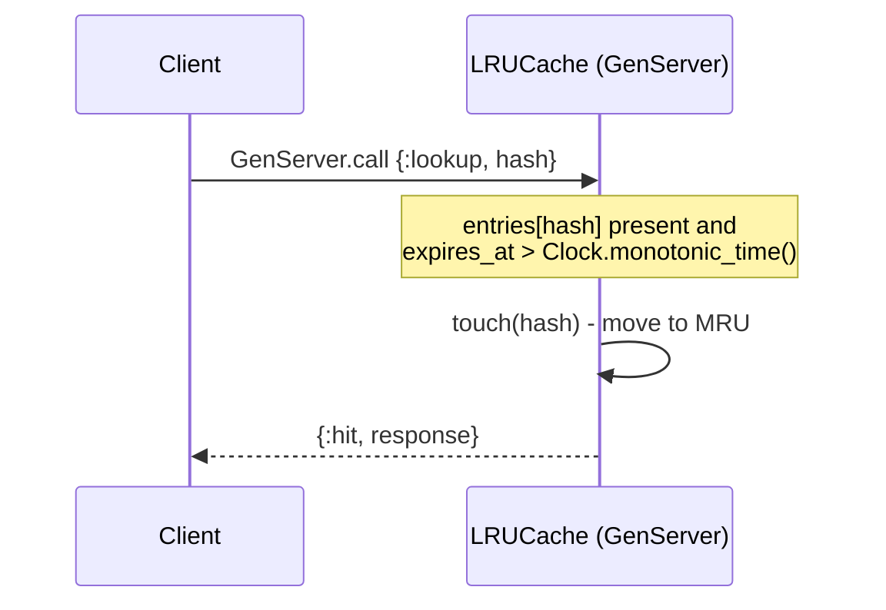
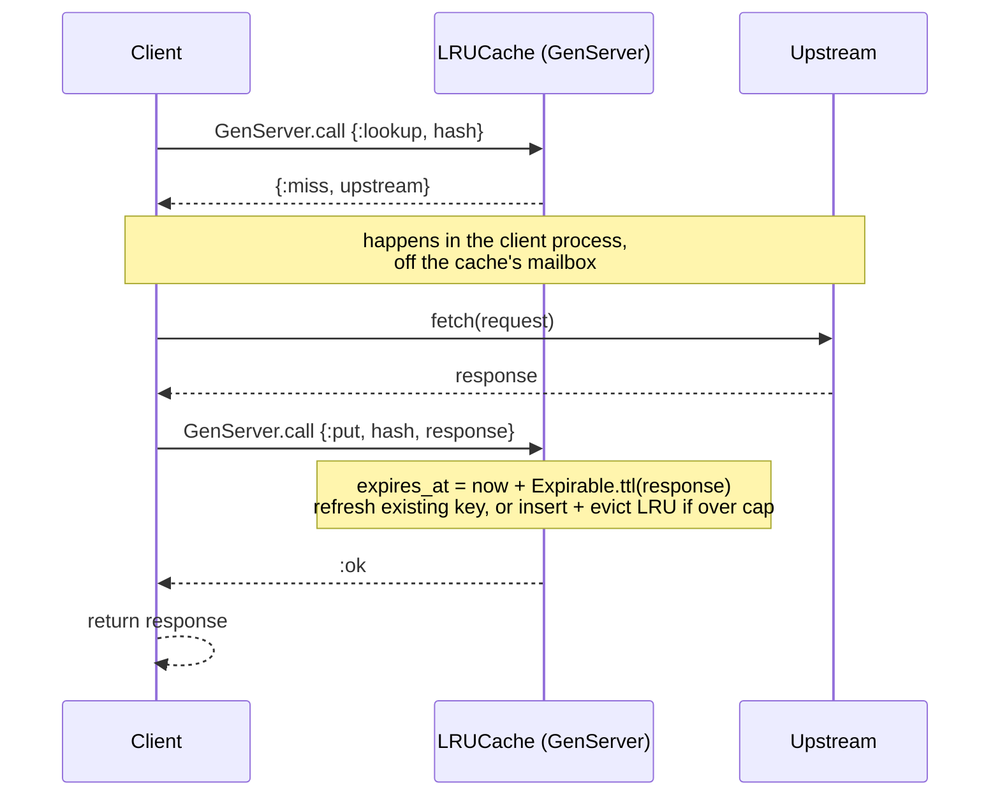

# Architecture

## Interface: behaviours and protocols

Two kinds of contract are used, matching the exercise's own phrasing ("protocols and/or
behaviours as appropriate"):

- **Behaviours** for "a module implements this": `Cache` (the public contract a cache exposes)
  and `Upstream` (the slow service being wrapped).
- **Protocols** for "this data type supports this operation": `Cacheable` (a request can be
  hashed) and `Expirable` (a response knows its own TTL).

`Clock` is a behaviour too (`AppworkCache.Clock.System` is its default, real implementation) -
it exists purely so TTL expiry can be driven by a controllable fake clock in tests instead of
`Process.sleep/1` and real elapsed time.

```mermaid
classDiagram
    class Cache {
        <<behaviour>>
        +start_link(opts) GenServer.on_start()
        +fetch(cache, request) response
    }
    class Upstream {
        <<behaviour>>
        +fetch(request) response
    }
    class Cacheable {
        <<protocol>>
        +hash(request) integer
    }
    class Expirable {
        <<protocol>>
        +ttl(response) integer
    }
    class Clock {
        <<behaviour>>
        +monotonic_time() integer
    }
    class ClockSystem["AppworkCache.Clock.System"] {
        <<module>>
    }
    class LRUCache {
        <<GenServer>>
        -cap: pos_integer
        -upstream: module
        -clock: module
        -entries: %{hash => {response, expires_at}}
        -order: [hash] (MRU-first)
        +start_link(opts)
        +fetch(cache, request)
    }

    LRUCache ..|> Cache : implements
    LRUCache --> Upstream : fetch/1, from the calling client process
    LRUCache --> Cacheable : hash(request)
    LRUCache --> Expirable : ttl(response), at insert time
    LRUCache --> Clock : monotonic_time()
    ClockSystem ..|> Clock : implements
```

## Data flow: hit vs. miss

`fetch/2` is a two-phase, client-driven flow rather than one `GenServer.call` that does
everything. The reason is concurrency: if the cache process made the (slow) upstream call itself
while holding its own mailbox, one caller's miss would block every other concurrent `fetch/2`
call - hits and misses on unrelated keys included. Splitting lookup and insert into two calls, and
making the *caller* responsible for the upstream round-trip in between, keeps the cache process's
work (map/list bookkeeping) fast and non-blocking.

**Hit path:**



**Miss path (absent or TTL-expired):**



Other concurrent `Client2`, `Client3`, ... calls to `Cache` are only ever blocked behind fast,
in-memory `handle_call`s - never behind `Upstream.fetch/1`. This is what was verified in
`AppworkCache.LRUCacheTest` ("concurrent fetches to different keys don't serialize behind a slow
upstream") and manually via `iex` (8 concurrent 100ms-upstream fetches completed in ~100ms total,
not ~800ms).

**Accepted tradeoff:** two concurrent misses on the *same* key can each independently call
upstream - there is no single-flight/in-flight-request deduplication. Adding that would mean
tracking per-key "fetch in progress" state and a waiter list, which is real complexity for a
scenario the exercise doesn't require handling; it was deliberately left out in favor of a
simpler, more obviously-correct implementation.

## Eviction and TTL bookkeeping

`entries` is a `%{hash => {response, expires_at}}` map for O(1) key lookup. `order` is a plain
list of hashes, most-recently-used first; `touch/2` is `List.delete/2` + prepend, and eviction
pops the list's tail. That's O(`cap`) per operation, not O(1) - an intentional
simplicity-over-optimization choice given the exercise's own guidance ("optimization is a bonus"
and V4 - the O(1) requirement - is explicitly not expected). See below for what V4 would change.

TTL is checked lazily, on lookup, against the injected `Clock` - there's no background sweep
process expiring entries proactively. `:cap` already bounds memory independent of TTL, so nothing
is gained by evicting an expired entry before anyone asks for it again. Refreshing an
already-present (possibly expired) key reuses the existing map entry rather than being treated as
a brand new insertion, so it can't wrongly trigger an eviction of an unrelated entry to "make
room" for something that was never actually new.

## V4 (not implemented): amortized O(1) fetch

The exercise says V4 is a stretch goal ("not expected to reach V4"), so it wasn't built - but the
concurrency architecture above (two-phase fetch, GenServer only doing fast in-memory work) needs
no changes to support it; only the recency bookkeeping's data structure would change.

The `List.delete/2` + prepend approach is O(`cap`) because finding and removing an arbitrary
element from a plain list requires a scan. The standard fix is the classic O(1) LRU structure: a
hash map for key lookup (already have this - `entries`) plus a **doubly linked list** for O(1)
"move to front" and O(1) "evict the tail," instead of a plain list.

In Elixir, without pulling in NIFs, this is naturally expressed by folding the linked-list pointers
into the entry itself and keeping it all inside the same `GenServer` state (still a single writer,
so no extra concurrency primitives needed - only the bookkeeping algorithm changes):

```elixir
entries: %{hash => %{response: r, expires_at: t, prev: prev_hash | :none, next: next_hash | :none}}
head: hash | :none  # most-recently-used
tail: hash | :none  # least-recently-used
```

- **Touch** (on a hit): unlink the node from its current position (O(1): rewrite its neighbors'
  `prev`/`next`), relink it as the new `head` (O(1)).
- **Evict** (on insert past `cap`): drop `tail`, relink the new tail's `next` to `:none` (O(1)).
- **Insert**: same as touch, from a freshly-created node.

This removes the only O(`cap`) step in the hot path, giving genuinely O(1) work per `fetch/2` call
on both the hit and miss-insert side (the upstream call itself is, of course, excluded from that
bound - it's the "slow" part by definition). ETS wasn't necessary for V1-V3's concurrency
requirement and wouldn't be necessary here either, for the same reason: every `fetch/2` mutates
recency state, so there's no genuinely lock-free read path to gain from moving storage out of the
GenServer's own state.
